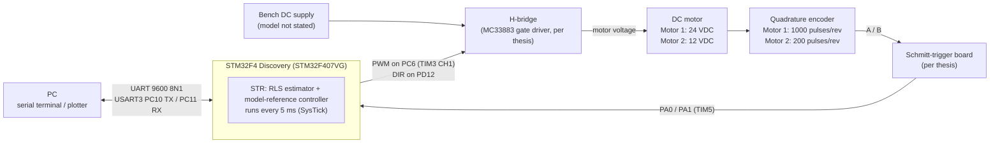
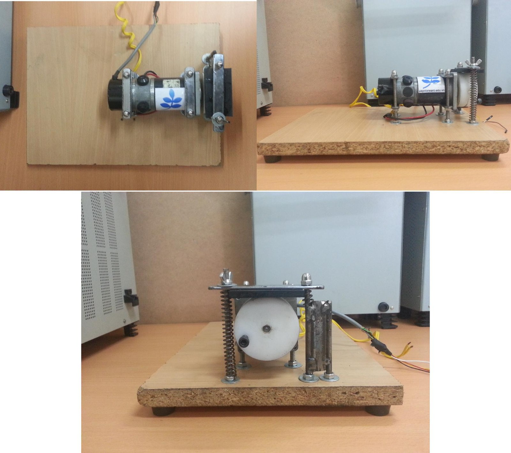
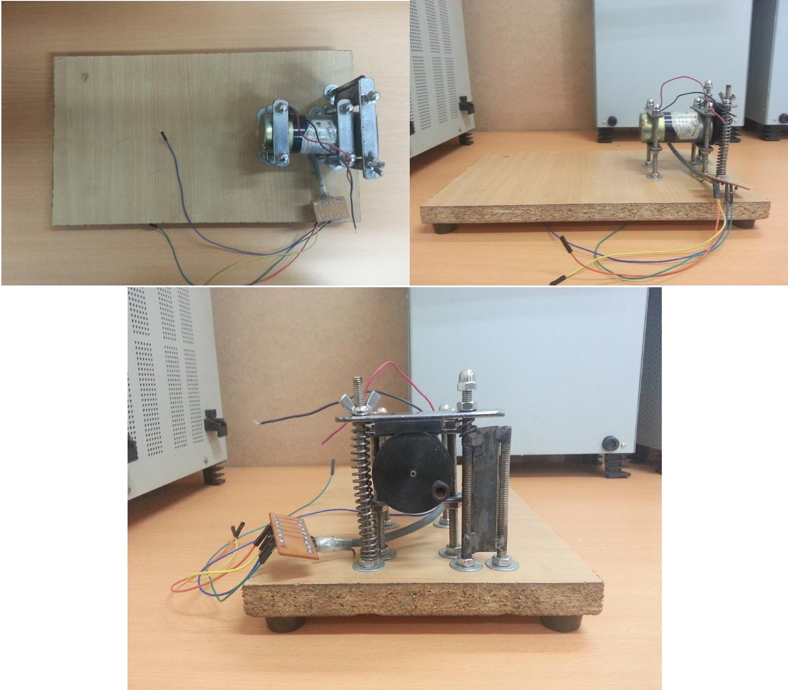

# Hardware

This folder describes the test rig used for the self-tuning regulator (STR) thesis project
(DC motor velocity and position control, 2013). It covers the boards, motors, H-bridge, encoder
wiring, timing and the STM32 pin map.

**How to read this page.** Everything here comes from three places, and each fact is tagged:

- **thesis**: the Vietnamese thesis `paper/thesis/Luan-van-tot-nghiep.pdf` (including its list of figures)
- **paper**: `paper/Design-a-Self-Tuning-Regulator-...pdf` and `paper/thesis/ThesisSTFinal.pdf`
- **from firmware**: read directly from the code in `firmware/` (and the compiled board-support files in the original Keil project)

Anything none of them say is marked **not stated**. No part numbers have been guessed.

---

## Overview

The STR reads the encoder, estimates the motor model online with recursive least squares, and
computes a new motor voltage every 5 ms. The STM32 sends that voltage to the H-bridge as a PWM
duty cycle plus a direction bit.

## Components

| Part | What the sources say | Source |
|---|---|---|
| Main controller | STM32F4 Discovery kit, STM32F407 MCU (ARM Cortex-M4F). Keil target device `STM32F407VG` | thesis (section "VI XỬ LÝ STM32F407 TRÊN KIT STM32F4 DISCOVERY", Fig. 7); from firmware (`Project.uvproj`) |
| Second / early board | "TIVAF4123 Launchpad" from Texas Instruments ("TI TIVAF4123G trên kit Tiva LaunchPad", Fig. 8 "kit vi điều khiển TivaF4"). Test code targets the `lm4f230h5qr` header from StellarisWare | thesis; from firmware (`firmware/tiva-lm4f-tests/`) |
| H-bridge | "Mạch cầu H MC33883" (H-bridge circuit, MC33883), Fig. 16, in section "MẠCH CẦU H". The MC33883 is an H-bridge **gate-driver** IC that drives external N-channel MOSFETs. Which MOSFETs, and the rest of the circuit, are **not stated** in the PDF in this repo (that section isn't included in it) | thesis (list of figures and table of contents) |
| Encoder signal conditioning | A Schmitt-trigger board cleans up the encoder signals (Figs. 17–20: signal after the Schmitt trigger, block diagram, schematic, board photo). The IC used is **not stated** in the PDF in this repo | thesis (list of figures) |
| Motor 1 | DC motor, **24 VDC**, encoder **1000 pulses/rev** (Fig. 27). Make and model **not stated** | thesis p.17 |
| Motor 2 | DC motor, **12 VDC**, encoder **200 pulses/rev** (Fig. 28). Make and model **not stated** | thesis p.17–18 |
| Other motors | The author says 4 different motors were tried in total. Only the two above are described | thesis ("chỉ đã thử trên 4 loại động cơ khác nhau") |
| Load | The paper's Fig. 6 says the two motors had different "operating voltage, encoder resolution and load weight". The photos show a spring-loaded plate pressing on a pulley on the motor shaft, which looks like an adjustable friction load. That reading is from the photos only; the text doesn't describe it | paper; photos |
| Power supply | The supply model is **not stated**. Motor voltage is 24 V or 12 V depending on the motor. Lab bench supplies can be seen in the background of the rig photos | thesis; photos |
| PC link | UART, interrupt driven. The author tried DMA but hit latency problems, and recommends USB (the Discovery's USB port) for future work | thesis ("VỀ PHẦN CỨNG HOẶC CODE LẬP TRÌNH"); from firmware |

The motor parameters in thesis Table 2 (J = 0.01 kg·m², b = 0.1 N·m·s, K = 0.01, R = 1 Ω, L = 0.5 H)
are the textbook example values used to derive the model ("Trong ví dụ này, chúng ta giả sử…" /
"in this example we assume…"). They are **not** measured specs of Motor 1 or Motor 2. That is the
point of the STR: it identifies each motor's parameters online.

## Photos

The only real hardware photos found are the two photos of the rig itself, taken in the lab for the
thesis in 2013. Each image is three views of the same rig: top, side and end-on.

*Motor 1 (24 VDC, 1000 pulses/rev encoder) on its wooden base, with the spring-loaded plate on the
white pulley. Source: thesis `Luan-van-tot-nghiep.pdf` page 17, Figure 27 "Mô hình động cơ 1". The same
end view appears as Figure 6 (left) in `ThesisSTFinal.pdf`, page 4.*

*Motor 2 (12 VDC, 200 pulses/rev encoder), with a small breakout board carrying the
encoder and motor leads out on jumper wires. Source: thesis page 18, Figure 28 "Mô hình động cơ 2".
The same end view appears as Figure 6 (right) in `ThesisSTFinal.pdf`, page 4.*

**Not available:** there's no photo of the STM32F4 Discovery board, the Tiva LaunchPad, the
MC33883 H-bridge board or the Schmitt-trigger board. The thesis lists figures for them (Figs. 7,
8, 16, 18–20), but those pages are not in the PDF in this repo, and no copies of them were found among
the author's files. Stock photos have deliberately not been used.

## H-bridge configuration (sign-magnitude drive)

From firmware (`firmware/main.c`, `firmware/stm32f4xx_it.c`):

- **Speed (magnitude):** one PWM output, **PC6 = TIM3 channel 1**, PWM mode 1, auto-reload
  3999, so the duty cycle runs from 0 to 3999 (0–100 %).
- **Direction:** **PD12** is a push-pull output. The controller output `u` is signed:
  `u ≥ 0` sets PD12 high, `u < 0` sets PD12 low, and the PWM duty is set to `|u|`, clamped at 3999.
- So the H-bridge takes one PWM line and one direction line (sign-magnitude). How those two lines
  connect to the MC33883 inputs, and any dead-time or enable wiring, is **not stated**.
- On the STM32F4 Discovery, PD12 also drives the green user LED (LD4), so the LED shows the motor
  direction.
- Sending `#` over the serial link sets the PWM to 0 (motor off) while switching between velocity
  and position mode.

## STM32F4 Discovery pin map

All from firmware.

| Pin | Peripheral | Direction | Function |
|---|---|---|---|
| **PC6** | TIM3_CH1 (AF2) | out | PWM to the H-bridge (motor voltage magnitude) |
| **PD12** | GPIO | out | Motor direction to the H-bridge (also the green LED on the Discovery) |
| **PA0** | TIM5_CH1 (AF2) in position mode; GPIO input with pull-up in velocity mode | in | Encoder channel A. In velocity mode its level is read on each B edge to get the direction |
| **PA1** | TIM5_CH2 (AF2) | in | Encoder channel B: input capture (velocity) or quadrature count (position) |
| **PC10** | USART3_TX | out | Serial to PC, 9600 baud 8N1 (pin from the compiled ST eval BSP, `EVAL_COM1` = USART3) |
| **PC11** | USART3_RX | in | Serial from PC: setpoint, mode switch |
| PD13 | GPIO | out | Timing debug: pulsed inside the 5 ms control interrupt (orange LED on Discovery) |
| PD14 | GPIO | out | High in velocity mode (red LED on Discovery) |
| PD15 | GPIO | out | High in position mode (blue LED on Discovery) |
| PB7 | TIM4_CH2 | in | Debug frequency measurement input (configured, but its interrupt is left disabled) |
| PD11 | GPIO | in, pull-up | Configured as an input but not used anywhere in the code |

The hardware random number generator (RNG) is also enabled. One firmware variant uses it to seed the
initial parameter vector (`firmware/variants/main_rng-theta-init.c`).

## Encoder measurement

From firmware, plus Figs. 25–26 in the thesis list of figures ("Phương pháp đo vận tốc bằng Input
Capture", "…đo vị trí bằng Quadrature Encoder Interface").

- **Velocity mode:** TIM5 runs in input-capture / PWM-input mode on channel B (PA1), with
  prescaler 64, so the timer ticks at 1.875 MHz. On each rising edge the period is captured, and
  `speed = 1,875,000 / period` gives pulses per second. Channel A (PA0) is read at that moment to
  find the direction. Speeds below 200 pulses/s are treated as 0. The velocity setpoint is also in
  pulses per second.
- **Position mode:** TIM5 runs in quadrature encoder mode `TI12` (counts on both edges of both
  channels, so 4 counts per encoder line) with a 32-bit counter. With Motor 1's 1000-pulse/rev
  encoder that would be 4000 counts/rev. That figure is inferred, not stated.

## Timing and clocks

| Item | Value | Source |
|---|---|---|
| Control / sample period | **5 ms** (SysTick interrupt, highest priority) | from firmware (`SysTick_Config(SystemCoreClock * 0.005)`); paper (`c2d(G, 0.005)`) |
| Core clock | `SystemCoreClock = 240 MHz` (PLL_M 8, PLL_N 480, PLL_P 2; the comments show the stock values 336 / 168 MHz). With the Discovery's 8 MHz crystal this runs the STM32F407 **above its 168 MHz rated maximum** | from firmware (`system_stm32f4xx.c`) |
| PWM frequency | The code comment says **21 kHz**, which assumes a 168 MHz core. At the 240 MHz actually configured, TIM3 runs at 120 MHz with prescaler 0 and ARR 3999, which gives **≈30 kHz**. The actual frequency used on the rig is **not stated** | from firmware |
| Encoder capture clock | 1.875 MHz (TIM5, = 240 MHz / 128). This constant only matches a 240 MHz core, which suggests the board really was run at 240 MHz | from firmware |
| Serial | USART3, **9600 baud**, 8 data bits, 1 stop bit, no parity, no flow control | from firmware |

## Serial link to the PC

From firmware (`USART3_IRQHandler`):

- Send a number followed by `*` to set the setpoint (velocity in pulses/s, or position in counts),
  for example `500*`.
- Send `#` to stop the motor and toggle between velocity mode and position mode.
- Results go back to the PC over the same UART. The response plots in the thesis appear to be
  captured from this serial data. Which PC program was used is **not stated**.
- MATLAB was used offline to design the reference models (`tf`, `c2d`). A live MATLAB link is
  **not stated**.

## Tiva / LM4F test board

The thesis names a TI "TIVAF4123 Launchpad" as the second Cortex-M4F platform. The two test
programs in `firmware/tiva-lm4f-tests/` show what was tried on it (from firmware):

| File | What it sets up |
|---|---|
| `Read_encoder.c` | Runs straight from the **16 MHz crystal** (no PLL). **QEI1** on PC5 (PhA1) / PC6 (PhB1), **QEI0** on PD6 (PhA0) / PD7 (PhB0); PD7 is a locked pin, and the code unlocks it. Quadrature mode, max position 100000, velocity window = SysClk/100 (10 ms). **UART0** on PA0 (RX) / PA1 (TX) at **921600 baud** (the comment says 115200) |
| `Systick.c` | PLL to **80 MHz**, PF1–PF3 as outputs (the LaunchPad's RGB LED pins), with SysTick toggling PF1 as a timing check |

> **Note:** The final controller runs on the STM32F4, which performed better. On the Tiva
> board, either the chip seemed unable to keep up with the STR computation or the code had a
> bug. Only these encoder and SysTick tests are kept here.

## What's missing

- No photos of the STM32F4 Discovery, the Tiva LaunchPad, the H-bridge board or the Schmitt-trigger board.
- The MC33883 H-bridge schematic, its MOSFETs and how the PWM/DIR lines connect to it.
- The Schmitt-trigger IC and schematic.
- Motor make/model, power-supply model and current ratings.

These were in the full thesis sections ("MẠCH CẦU H", "PHỤ LỤC THÔNG SỐ KỸ THUẬT"), which aren't in
the PDF in this repo.

---

Author: Khoa Nguyen
